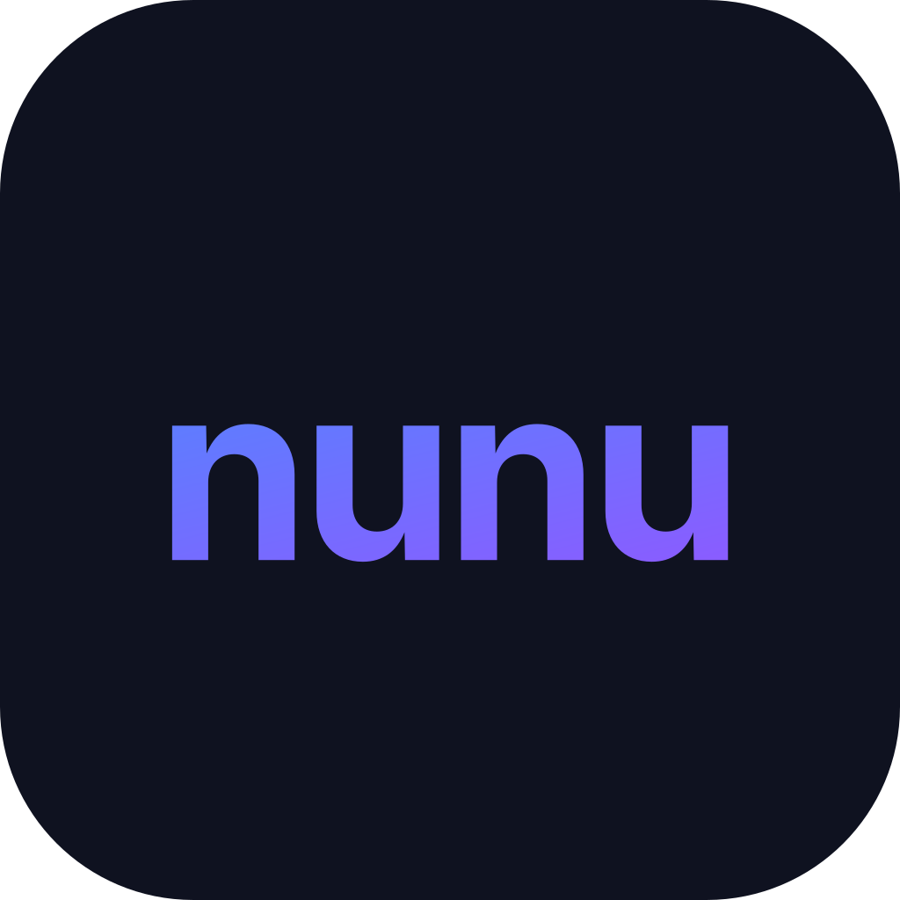

<p align="center">
  
</p>

# nunu

Run Android games on your Mac or Windows PC.

On Apple Silicon, nunu is a native Swift app. Android runs as ARM64 on the M-series cores through Hypervisor.framework, with no translation, and games draw on the Mac GPU through Metal.

---

## Download

Grab the latest build from [Releases](https://github.com/wisnuub/nunu/releases):

| Platform | File | Notes |
|---|---|---|
| macOS (Apple Silicon) | `nunu-x.x.x-arm64.dmg` | Drag to Applications. Right-click then Open on first launch. macOS 15 or newer. |
| Windows (x64) | `nunu Setup x.x.x.exe` | Run the installer. Click "More info then Run anyway" if SmartScreen appears. |

---

## Features (macOS)

- **nunu Home**: your games and apps in one place, with Play Store icons, a popular games row, and download progress.
- **App tabs**: open apps show as tabs in the title bar. Click to switch, close to free memory.
- **Game controls**: map keys to the screen, a WASD stick, mouse aim and a fire button. Each game keeps its own layout, and the mouse can lock for aiming (Control plus Option releases it).
- **Touch ID**: use your Mac's fingerprint when Android asks for one.
- **Install from Mac**: drag an `.apk`, `.apks` or `.xapk` onto the window, or double-click one in Finder.
- **Google Play**: nunu uses Google's certified Android 14 Google Play image. Play Store and Play Services are built in.
- **Root (optional)**: a toggle in Settings boots a KernelSU + SUSFS kernel so apps can get root, with SUSFS hiding it from detection. Turning it off boots the stock kernel with no trace. Device profiles spoof a real phone's fingerprint.
- **Quick boot**: quitting saves Android's state, so the next launch resumes in seconds.
- **Tuning**: pick CPU cores, memory, resolution and frame rate. nunu also turns off unneeded preinstalled apps, which you can switch back on.

---

## How it works (macOS)

```
nunu.app (Swift, AppKit + Metal)
        |
        v
Android VM engine (Google's emulator engine, downloaded to ~/.nunu on first run)
    CPU:  Hypervisor.framework, ARM64 guest on ARM64 host, no translation
    GPU:  gfxstream, guest OpenGL ES / Vulkan forwarded to Metal
```

The engine runs with its window hidden. nunu draws Android in its own Metal window. Frames are shared through memory with no copy, and input goes back over one gRPC stream. First launch downloads the engine and the Android 14 image straight from Google, so no Java or Android Studio is needed.

Full detail is in [macos/README.md](macos/README.md).

---

## Build from source

### macOS app

Swift package in [`macos/`](macos/). Needs macOS 15 or newer and Xcode 16 or newer.

```bash
cd macos
swift build && .build/debug/Nunu    # dev run
scripts/build-app.sh --dmg          # build the app and a DMG
```

### Windows launcher

Electron app in `electron/` and `src/`. Needs Node.js 20 or newer.

```bash
npm install
npm run electron:dev                 # dev run
npm run electron:build:win           # build the installer
```

---

## Repos

| Repo | Role |
|---|---|
| [nunu](https://github.com/wisnuub/nunu) | macOS app (`macos/`) and the Windows launcher (`electron/`, `src/`) |
| [nunu-windows](https://github.com/wisnuub/nunu-windows) | Windows VM engine, QEMU plus WHPX |

---

## Data location

Everything lives under `~/.nunu/`. Delete this folder to fully uninstall.

| Path | Purpose |
|---|---|
| `~/.nunu/sdk/` | Android VM engine, platform-tools and system image |
| `~/.nunu/avd/` | Android device files and the quick-boot snapshot |
| `~/.nunu/root/` | KernelSU kernel, manager app and device-profile module (only if root is used) |
| `~/.nunu/keymaps/` | Per-game controls |
| `~/.nunu/library/` | Cached app names and icons |
| `~/.nunu/logs/` | `nunu.log` and `engine.log` |
